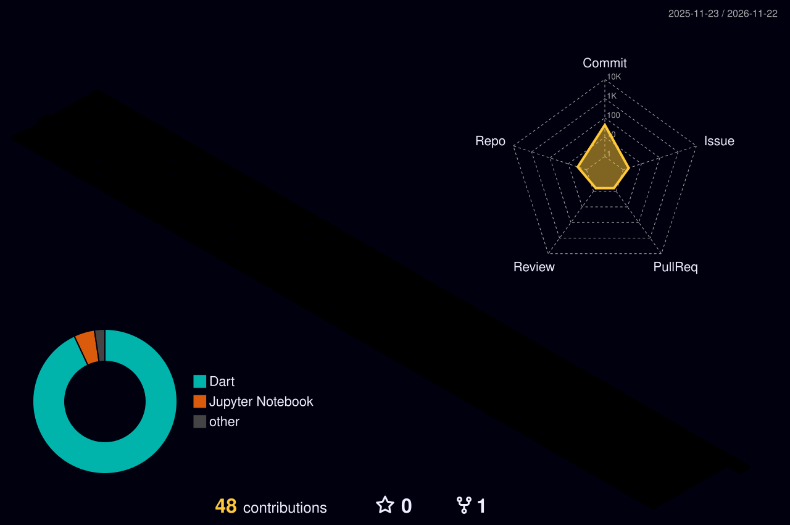

<!-- Header banner -->

  

  
  
  

---

##  About me

- 🧑‍🎓 Studying **Chemical Engineering** at **IIT Guwahati**
- 🔬 Applying **machine learning to process engineering**: fluidized beds, heat integration, industrial data
- 🌱 Currently learning **deep learning frameworks** and **model deployment**
- 📱 Building **Flutter** apps and small **web projects** on the side
- 🛠️ Comfortable with **Aspen Plus, ANSYS Fluent and MATLAB** as well as code
- 💬 Ask me about **ML for engineering, Flutter, or data analysis**

 

---

## 🚀 Featured projects

<table>
<tr>
<td width="50%" valign="top">

### 🫧 [Bubble Diameter Predictor](https://github.com/Ankit-OO7/Bubble_diameter_Predictor)
CatBoost model + Streamlit app that predicts bubble size in gas–solid fluidized beds from 13 operating parameters.
 `Python` `CatBoost` `Streamlit`

</td>
<td width="50%" valign="top">

### 🔥 [AI-based Pinch Analysis](https://github.com/Ankit-OO7/AI_based_Pinch_Analysis)
Reads P&ID drawings (DXF) to extract heat exchangers and process loops automatically for heat-integration analysis.
 `ezdxf` `NetworkX` `pandas`

</td>
</tr>
<tr>
<td width="50%" valign="top">

### 💳 [Credit Risk Analysis](https://github.com/Ankit-OO7/Credit_Risk_Analysis)
Loan-default prediction on 32k borrowers, with KNN imputation, SMOTE and a model comparison. Random Forest reached 93% accuracy.
 `scikit-learn` `imbalanced-learn`

</td>
<td width="50%" valign="top">

### 🌍 [Heritage Sites Globe](https://ankit-oo7.github.io/Heritage_sites_globe/)
Interactive 3D rotating globe showing every UNESCO World Heritage Site with details.
 `JavaScript` `three.js`

</td>
</tr>
<tr>
<td width="50%" valign="top">

### 🍔 [Sizzle: Food Delivery App](https://github.com/Ankit-OO7/Food-Delivery-App-Sizzle)
Flutter app with Firebase auth, add-ons, cart, receipts and dark mode.
 `Flutter` `Dart` `Firebase`

</td>
<td width="50%" valign="top">

### 📦 [Inventory Analytics & Optimization](https://github.com/Ankit-OO7/Urban_Retail_inventory_management)
SQL-driven inventory monitoring, forecasting and reorder optimization for a retail chain.
 `SQL`

</td>
</tr>
</table>

---

##  Tech stack

<table align="center">
<tr><td align="center"><b>💻 Languages</b></td><td></td></tr>
<tr><td align="center"><b>🤖 ML & Data</b></td><td>

 

</td></tr>
<tr><td align="center"><b>📱 App & Web</b></td><td></td></tr>
<tr><td align="center"><b>🗄️ Databases</b></td><td></td></tr>
<tr><td align="center"><b>🧰 Tools & OS</b></td><td></td></tr>
<tr><td align="center"><b>⚗️ Engineering</b></td><td>

</td></tr>
<tr><td align="center"><b>🏆 Problem solving</b></td><td>

</td></tr>
</table>

---

## 🌍 Explore in 3D

  

---

## 🏙️ My contributions in 3D

  <picture>
    <source media="(prefers-color-scheme: dark)" srcset="./profile-3d-contrib/profile-night-rainbow.svg" />
    <source media="(prefers-color-scheme: light)" srcset="./profile-3d-contrib/profile-green-animate.svg" />
    
  </picture>

---

## 🐍 A snake eating my contributions

  <picture>
    <source media="(prefers-color-scheme: dark)" srcset="https://raw.githubusercontent.com/Ankit-OO7/Ankit-OO7/output/github-snake-dark.svg" />
    <source media="(prefers-color-scheme: light)" srcset="https://raw.githubusercontent.com/Ankit-OO7/Ankit-OO7/output/github-snake.svg" />
    
  </picture>

---

## ✍️ Quote of the day

  

<!-- Footer banner -->

